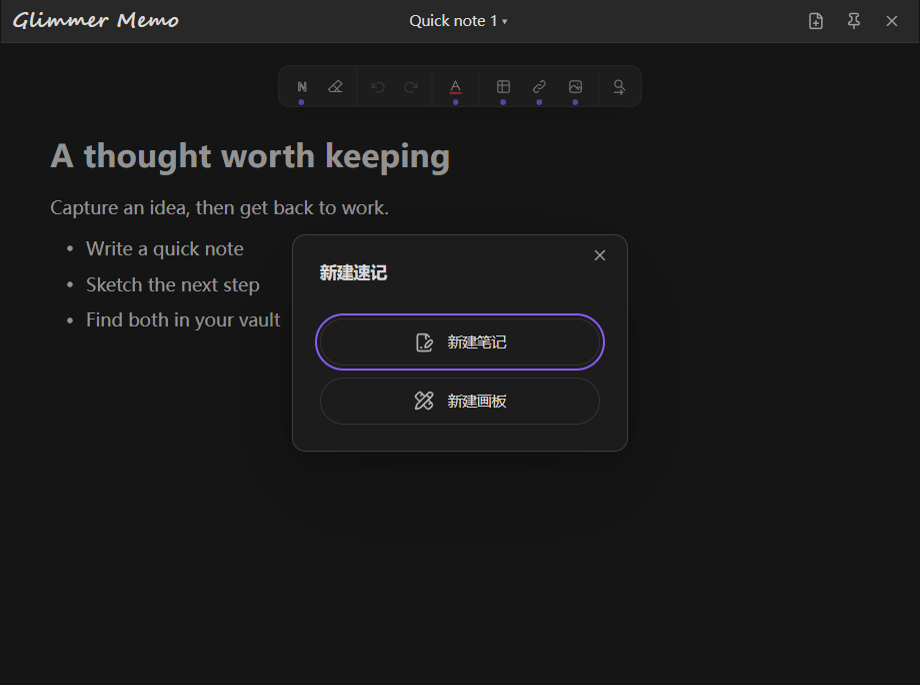

<p align="center">
  
</p>

<h1 align="center">Glimmer Memo</h1>

<p align="center">Floating text notes and Excalidraw sketches for Obsidian. Capture a thought, then get back to work.</p>

<p align="center">English · <a href="README.zh-CN.md">简体中文</a></p>

Open Glimmer Memo with one shortcut, type a note or sketch, and click elsewhere to save and hide it. The next time you open Glimmer Memo, your current file is still there. Text notes use Obsidian's native Markdown editor; drawings use Excalidraw. Both stay as ordinary files in your vault.


## Highlights

- **One shortcut, one familiar canvas.** Show or hide the same scratchpad; optionally use a system-wide shortcut on Windows x64.
- **Out of the way when you need it.** Save and hide on focus loss with a short fade-out and no added blur delay, or pin the canvas above other windows.
- **Files within reach.** Click the title to switch notes and drawings, distinguished by small icons; double-click to rename.
- **A fresh page without losing the last one.** Choose a text note or canvas when creating a new memo. The current file is saved and keeps its filename and location.
- **Your vault, your files.** Choose a drawing folder, embed drawings with `![[...]]`, and keep them when you disable the plugin.
- **Optional background access.** Integrate with Tray to keep Obsidian running when its main window closes.

## Requirements and installation

Glimmer Memo requires **Obsidian desktop 1.10.0 or later** and the [Excalidraw community plugin](https://github.com/zsviczian/obsidian-excalidraw-plugin), installed and enabled. It is independent of Blo Editor. Mobile is not supported; the system-wide shortcut is currently limited to **Windows x64**.

### Manual installation

1. Install and enable Excalidraw in **Settings → Community plugins**.
2. Download `glimmer-memo-<version>.zip` from [GitHub Releases](https://github.com/OrlandoHsu29/obsidian-glimmer-memo/releases), or [build it from source](#build-from-source).
3. Extract its top-level `glimmer-memo/` folder into `<vault>/.obsidian/plugins/`. Keep the complete folder, including `manifest.json`, `main.js`, `styles.css`, `LICENSE`, and the Windows hotkey helper.
4. Reload Obsidian and enable **Glimmer Memo** under Community plugins.
5. Press **Ctrl + Alt + Y**, click the ribbon button, or run **Glimmer Memo: Show/hide quick memo** from the command palette.

On first use, Glimmer Memo creates `Glimmer Memo/Quick sketch 1.excalidraw.md`. It then reopens the current note or drawing. New files use the next available number on name collisions; existing names are preserved. Excalidraw is needed for drawings; existing text notes work without it.

When migrating from an earlier installation, copy its `data.json` and `data.json.bak` into the new plugin directory before enabling Glimmer Memo. The saved creation folder and current file path remain in use; existing vault files are not renamed or moved. Custom command hotkeys and URI launchers need the new plugin ID.

When updating, disable the global shortcut and then the plugin before replacing runtime files. Preserve your `data.json` and its `data.json.bak` backup, then enable the plugin again.

## Using Glimmer Memo

### Show, hide, and pin

| Action | Result |
| --- | --- |
| **Ctrl + Alt + Y** by default | Show or hide the canvas |
| Click elsewhere | Save and hide when unpinned; enabled by default |
| Pin button | Keep the canvas visible and above other windows |
| **Esc** or close button | Save and hide, including when pinned |
| Drag the title bar / resize the window | Move or resize; bounds are remembered |

Turn off **Hide on focus loss** if you prefer the canvas to stay visible. Drawing menus and text editing receive Esc first; finish editing or close the menu before using Esc to hide the window.

Glimmer Memo's own popout is excluded from saved workspace layouts, so starting Obsidian does not recreate it, including when pinned. During normal exit, Glimmer Memo also requests a final drawing save; use the shortcut to reopen it next time.

Excalidraw handles drawing and autosave; Obsidian handles Markdown editing. Glimmer Memo requests the appropriate editor's save before hiding, switching, renaming or creating files. It keeps the main renderer awake while the memo is visible and during saving, including when the main window is minimized, then restores its previous background throttling setting.

Saving and the short fade-out start together, so the canvas responds without waiting for disk saving. The window is hidden only after both complete; a save failure restores the visible canvas and shows an error.

### Switch notes and drawings, and rename

Single-click the filename in the title bar to browse notes and drawings in the configured folder and its subfolders. Small drawing and document icons distinguish canvases from text notes. Long titles are shortened with an ellipsis to keep the list compact; hover a row to read its full name. Each row shows the file's last modified time on the right. Selecting one saves the current file before switching.


Double-click the filename to rename it in place. Press **Enter** to save or **Esc** to cancel; the original extension is preserved.

### Create a note or canvas

Click the new file button, then select **New note** or **New sketch** in the compact chooser. Glimmer Memo saves the current file, then opens a new blank memo in the same window. Every existing file keeps its filename and location.



Text notes use `Quick note 1.md`; canvases use `Quick sketch 1.excalidraw.md` (or `.excalidraw` in compatibility mode). Both use the first available number in the configured creation folder. No existing files are renamed or moved. If saving fails, no new file is created; a creation failure leaves the original intact.

### Settings

Settings are grouped into **Window behavior**, **Keyboard shortcut**, and **Memo files**, with related controls sharing a card.

- **Window behavior:** close to system tray through Tray, and hide on focus loss.
- **Keyboard shortcut:** enable global scope and change the window activation shortcut.
- **Memo files:** set the creation folder relative to the vault root and see the current file's path. New notes and drawings are stored in this folder; existing files retain their filenames and locations.

The interface follows Obsidian's language, with Chinese and English translations. The default shortcut is **Ctrl + Alt + Y**.

## Keyboard shortcut

Configure one combination using **Change** beside **Window activation shortcut**:

| Global shortcut switch | Where the combination works |
| --- | --- |
| On — Windows x64 | In other apps and while Obsidian is minimized or running in the background |
| Off | Inside Obsidian only |

Changing the shortcut temporarily releases the existing binding. Cancel with Esc, an outside click, or a window switch to restore it. Conflicts with another app or vault are reported rather than replacing their binding. The ribbon button and command palette remain available.

The bundled C helper, `glimmer-memo-hotkey.exe`, uses Windows `RegisterHotKey` and a blocking message loop: no polling, keyboard hooks, or script runtime. It runs only while global shortcuts are enabled and exits when the feature or plugin is disabled, or Obsidian exits. AutoHotkey, PowerToys, and Rust are not required.

External launchers can also use:

```text
obsidian://glimmer-memo?vault=YOUR_PERCENT_ENCODED_VAULT_NAME
```

Without the vault parameter, whichever vault receives the URI handles it. **Obsidian and the required plugins must remain running**; Glimmer Memo is not a separate desktop application.

## Keep Obsidian in the system tray

1. Install and enable [Tray by dragonwocky](https://github.com/dragonwocky/obsidian-tray) from Obsidian's community plugins.
2. Enable **Close to system tray** in Glimmer Memo settings.
3. Close Obsidian's main window. The vault can remain running, keeping Glimmer Memo's global shortcut available.

Glimmer Memo shows an installation link or enable button if needed. The switch updates Tray's background setting, enables its tray icon, and reloads Tray to apply the change; its other preferences are preserved. To close the vault completely, choose **Close Vault** in Tray's menu.

Restoring Obsidian from Tray keeps hidden Glimmer Memo canvases hidden. Hiding a visible canvas through Tray requests a save. Disabling Glimmer Memo does not turn off Tray's background mode. Tray is optional, independently maintained, and not bundled with Glimmer Memo.

## Recovery and compatibility

- Settings are written to a temporary file and replaced only after writing completes. A valid previous copy is kept in `data.json.bak`; damaged settings are recovered from a valid backup instead of silently resetting your drawing and shortcut.
- If the current drawing is deleted, its window hides automatically without trying to save the deleted file. Reopening Glimmer Memo creates a new numbered drawing.
- If a save or another canvas operation fails, an error dialog offers **Confirm and close**. This closes the faulty window without retrying the failed save. Saved files remain; unsaved changes may be lost. Reopen Glimmer Memo to return to the saved drawing. Filename validation errors remain notices so you can correct them.
- The desktop workflow was tested on Windows x64 with Obsidian **1.14.4** and Excalidraw **2.29.0**. Tray integration was tested with **Tray 0.3.5**. Other desktop platforms have not been verified.
- Window control uses Obsidian's internal popout `electronWindow` interface; Excalidraw and Tray integrations also depend on plugin interfaces. Future updates may require adaptation. Compatibility with every version or platform is not guaranteed.

## Build from source

Node.js **22** is recommended. Building the Windows helper requires Visual Studio Build Tools with the **Desktop development with C++** workload.

Run in Windows PowerShell:

```powershell
npm.cmd ci
npm.cmd run typecheck
npm.cmd test
npm.cmd run package
```

The installable folder is `dist/glimmer-memo/`; the ZIP is `releases/glimmer-memo-<version>.zip`, containing a top-level `glimmer-memo/` folder. Install the complete folder using the steps above.

## License and acknowledgements

[MIT](LICENSE) © OrlandoHsu29.

- [Excalidraw for Obsidian](https://github.com/zsviczian/obsidian-excalidraw-plugin) provides drawing and file saving, and is distributed separately under its own license. Glimmer Memo does not bundle a drawing engine.
- [Tray](https://github.com/dragonwocky/obsidian-tray) provides optional background operation under its own MIT license.
- [Floating Notes](https://github.com/haotiencheng/obsidian-floating-notes) was a reference when evaluating the floating-window workflow. It is not a dependency; Glimmer Memo implements its own window controller.
- The title bar wordmark uses the system font **Segoe Script**, with cursive fallbacks. No font files are bundled.
