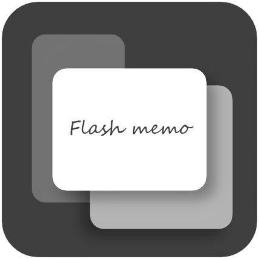
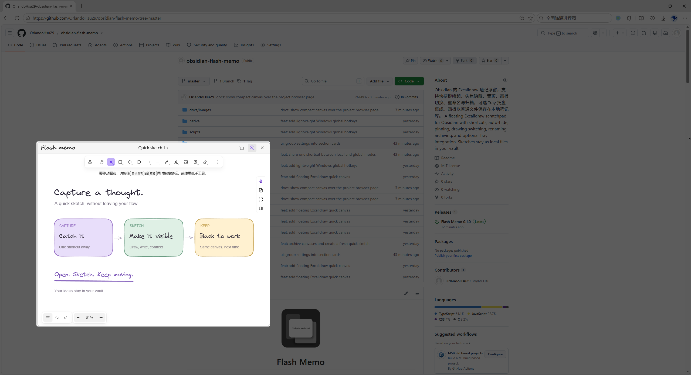
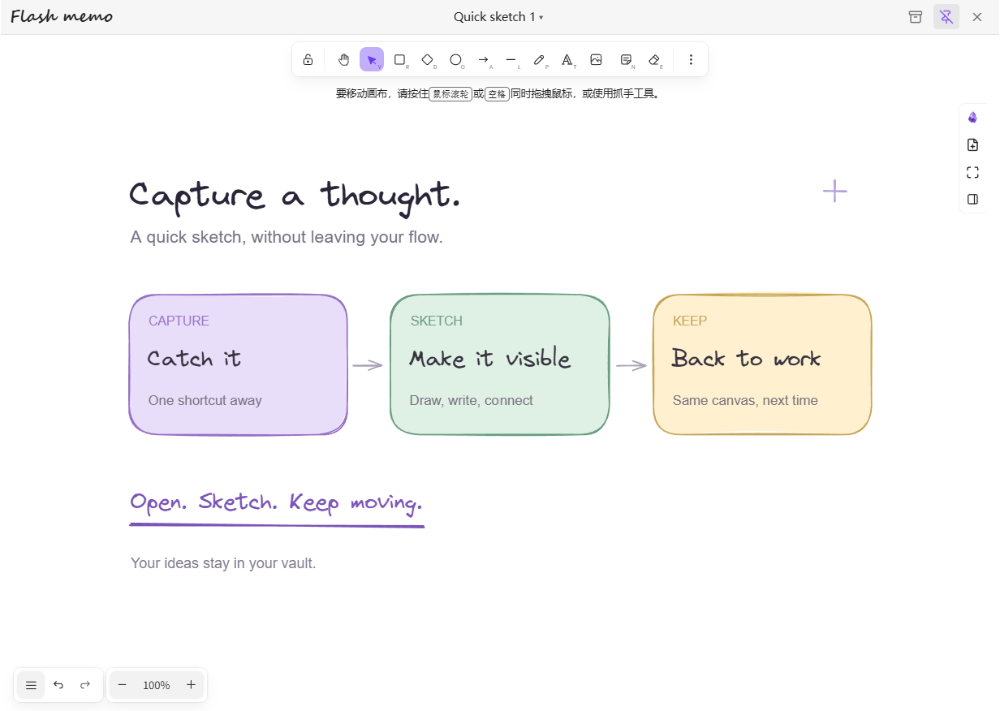
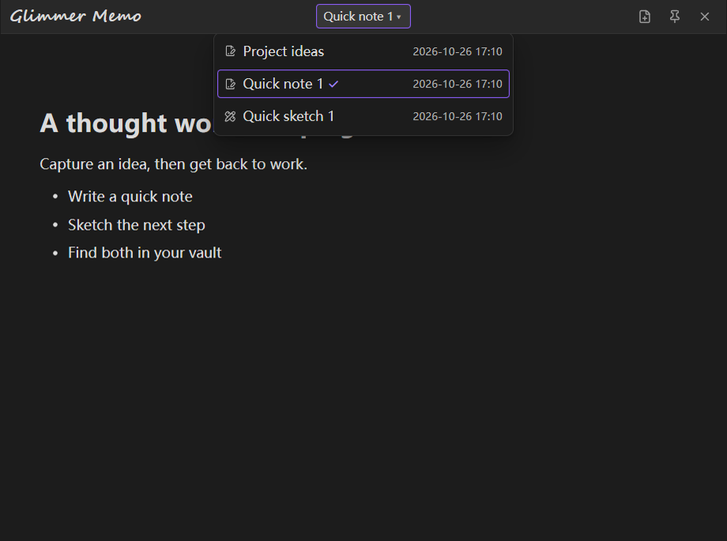
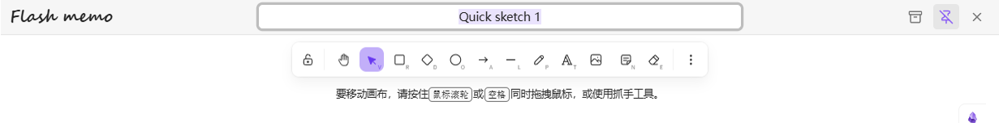
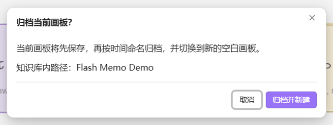
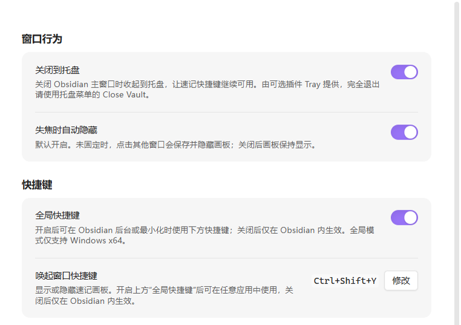

<p align="center">
  
</p>

<h1 align="center">Flash Memo</h1>

<p align="center">A floating Excalidraw scratchpad for Obsidian. Capture a thought, then get back to work.</p>

<p align="center">English · <a href="README.zh-CN.md">简体中文</a></p>



*Author-supplied screenshot, with the background dimmed to highlight Flash Memo's compact floating canvas above the project page.*

Open a canvas with one shortcut, sketch or write, and click elsewhere to save and hide it. The next time you open Flash Memo, your drawing is still there. Drawings stay as ordinary Excalidraw files in your vault, ready to open or embed in your notes.

## Highlights

- **One shortcut, one familiar canvas.** Show or hide the same scratchpad; optionally use a system-wide shortcut on Windows x64.
- **Out of the way when you need it.** Save and hide on focus loss with a short fade-out and no added blur delay, or pin the canvas above other windows.
- **Files within reach.** Click the title to switch drawings; double-click to rename.
- **A fresh page without losing the last one.** Archive the current drawing after confirmation and continue on a blank canvas.
- **Your vault, your files.** Choose a drawing folder, embed drawings with `![[...]]`, and keep them when you disable the plugin.
- **Optional background access.** Integrate with Tray to keep Obsidian running when its main window closes.

## Requirements and installation

Flash Memo requires **Obsidian desktop 1.10.0 or later** and the [Excalidraw community plugin](https://github.com/zsviczian/obsidian-excalidraw-plugin), installed and enabled. It is independent of Blo Editor. Mobile is not supported; the system-wide shortcut is currently limited to **Windows x64**.

### Manual installation

1. Install and enable Excalidraw in **Settings → Community plugins**.
2. Download `flash-memo-<version>.zip` from [GitHub Releases](https://github.com/OrlandoHsu29/obsidian-flash-memo/releases), or [build it from source](#build-from-source).
3. Extract its top-level `flash-memo/` folder into `<vault>/.obsidian/plugins/`. Keep the complete folder, including `manifest.json`, `main.js`, `styles.css`, `LICENSE`, and the Windows hotkey helper.
4. Reload Obsidian and enable **Flash Memo** under Community plugins.
5. Press **Ctrl + Alt + Y**, click the ribbon button, or run **Flash Memo: Show/hide quick canvas** from the command palette.

On first use, Flash Memo creates `Flash Memo/Quick sketch 1.excalidraw.md`. It then reopens the current drawing. New drawings use the next available number on name collisions; existing names are preserved.

When updating, disable the global shortcut and then the plugin before replacing runtime files. Preserve your `data.json`, then enable the plugin again.

## Using Flash Memo

### Show, hide, and pin



| Action | Result |
| --- | --- |
| **Ctrl + Alt + Y** by default | Show or hide the canvas |
| Click elsewhere | Save and hide when unpinned; enabled by default |
| Pin button | Keep the canvas visible and above other windows |
| **Esc** or close button | Save and hide, including when pinned |
| Drag the title bar / resize the window | Move or resize; bounds are remembered |

Turn off **Hide on focus loss** if you prefer the canvas to stay visible. Drawing menus and text editing receive Esc first; finish editing or close the menu before using Esc to hide the window.

Excalidraw handles drawing and autosave. Flash Memo also requests a save before hiding or switching drawings. It keeps the main renderer awake while the canvas is visible and during saving, including when the main window is minimized, then restores its previous background throttling setting.

### Switch drawings and rename

Single-click the filename in the title bar to browse drawings in the configured folder and its subfolders, including archived drawings. Selecting one saves the current canvas before switching.



Double-click the filename to rename it in place. Press **Enter** to save or **Esc** to cancel; the `.excalidraw.md` extension is preserved.



### Archive and start fresh

Click the archive button and confirm. Flash Memo saves the drawing, moves it to a timestamped filename, and opens a new blank drawing in the same window.



Archive names resemble `Sketch 2026-10-18 12-30-05.excalidraw.md`, with a number added on collisions. Files are moved through Obsidian's file manager to maintain note links. Save or creation failures do not delete the old drawing.

### Settings

Settings are grouped into **Window behavior**, **Keyboard shortcut**, and **Drawing files**, with related controls sharing a card.



- **Window behavior:** close to system tray through Tray, and hide on focus loss.
- **Keyboard shortcut:** enable global scope and change the window activation shortcut.
- **Drawing files:** set the creation folder relative to the vault root and see the current drawing's path. New and archived drawings are stored in this folder.

Screenshots show the Simplified Chinese interface and temporary demo drawings. The pictured **Ctrl + Shift + Y** is a customized shortcut; the default is **Ctrl + Alt + Y**. The interface follows Obsidian's language, with Chinese and English translations.

## Keyboard shortcut

Configure one combination using **Change** beside **Window activation shortcut**:

| Global shortcut switch | Where the combination works |
| --- | --- |
| On — Windows x64 | In other apps and while Obsidian is minimized or running in the background |
| Off | Inside Obsidian only |

Changing the shortcut temporarily releases the existing binding. Cancel with Esc, an outside click, or a window switch to restore it. Conflicts with another app or vault are reported rather than replacing their binding. The ribbon button and command palette remain available.

The bundled C helper, `flash-memo-hotkey.exe`, uses Windows `RegisterHotKey` and a blocking message loop: no polling, keyboard hooks, or script runtime. It runs only while global shortcuts are enabled and exits when the feature or plugin is disabled, or Obsidian exits. AutoHotkey, PowerToys, and Rust are not required.

External launchers can also use:

```text
obsidian://flash-memo?vault=YOUR_PERCENT_ENCODED_VAULT_NAME
```

Without the vault parameter, whichever vault receives the URI handles it. **Obsidian and the required plugins must remain running**; Flash Memo is not a separate desktop application.

## Keep Obsidian in the system tray

1. Install and enable [Tray by dragonwocky](https://github.com/dragonwocky/obsidian-tray) from Obsidian's community plugins.
2. Enable **Close to system tray** in Flash Memo settings.
3. Close Obsidian's main window. The vault can remain running, keeping Flash Memo's global shortcut available.

Flash Memo shows an installation link or enable button if needed. The switch updates Tray's background setting, enables its tray icon, and reloads Tray to apply the change; its other preferences are preserved. To close the vault completely, choose **Close Vault** in Tray's menu.

Restoring Obsidian from Tray keeps hidden Flash Memo canvases hidden. Hiding a visible canvas through Tray requests a save. Disabling Flash Memo does not turn off Tray's background mode. Tray is optional, independently maintained, and not bundled with Flash Memo.

## Recovery and compatibility

- If the current drawing is deleted, its window hides automatically without trying to save the deleted file. Reopening Flash Memo creates a new numbered drawing.
- If a save or another canvas operation fails, an error dialog offers **Confirm and close**. This closes the faulty window without retrying the failed save. Saved files remain; unsaved changes may be lost. Reopen Flash Memo to return to the saved drawing. Filename validation errors remain notices so you can correct them.
- Preview screenshots were captured on Windows x64 with Obsidian **1.14.4** and Excalidraw **2.29.0**. Tray integration was tested with **Tray 0.3.5**. Other desktop platforms have not been verified.
- Window control uses Obsidian's internal popout `electronWindow` interface; Excalidraw and Tray integrations also depend on plugin interfaces. Future updates may require adaptation. Compatibility with every version or platform is not guaranteed.

## Build from source

Node.js **22** is recommended. Building the Windows helper requires Visual Studio Build Tools with the **Desktop development with C++** workload.

Run in Windows PowerShell:

```powershell
npm.cmd ci
npm.cmd run typecheck
npm.cmd test
npm.cmd run package
```

The installable folder is `dist/flash-memo/`; the ZIP is `releases/flash-memo-<version>.zip`, containing a top-level `flash-memo/` folder. Install the complete folder using the steps above.

## License and acknowledgements

[MIT](LICENSE) © OrlandoHsu29.

- [Excalidraw for Obsidian](https://github.com/zsviczian/obsidian-excalidraw-plugin) provides drawing and file saving, and is distributed separately under its own license. Flash Memo does not bundle a drawing engine.
- [Tray](https://github.com/dragonwocky/obsidian-tray) provides optional background operation under its own MIT license.
- [Floating Notes](https://github.com/haotiencheng/obsidian-floating-notes) was a reference when evaluating the floating-window workflow. It is not a dependency; Flash Memo implements its own window controller.
- The title bar wordmark uses the system font **Segoe Script**, with cursive fallbacks. No font files are bundled.
